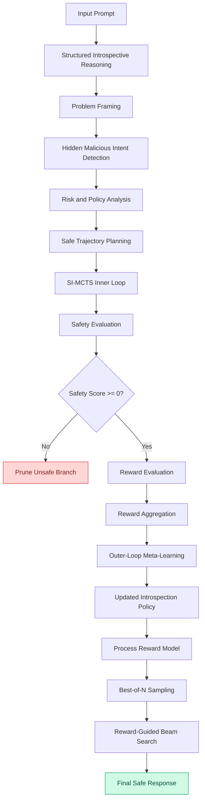

# META-IR Architecture

## 1. Overview

META-IR (Meta-Introspective Reasoning for Adaptive Safety Alignment in Large Language Models) is a meta-introspective reasoning framework designed to improve safety alignment, reasoning reliability, and robustness against evolving jailbreak attacks.

The framework integrates four principal mechanisms:

1. Structured Introspective Reasoning.
2. Safety-Informed Monte Carlo Tree Search (SI-MCTS).
3. Composite Reward Optimization.
4. Dual-Loop Meta-Learning.

META-IR additionally employs meta-adaptive response generation using a process reward model, Best-of-N sampling, and reward-guided Beam Search.

The architecture separates structured risk analysis, safety-aware trajectory refinement, cross-task policy adaptation, and final response selection.

---

## 2. High-Level Architecture

The META-IR framework consists of three interconnected stages:

- **Stage 1: Structured Introspective Reasoning**
- **Stage 2: Meta-Introspective Dual-Loop Self-Improvement**
- **Stage 3: Meta-Adaptive Response Generation**

### Overall Architecture



---

## 3. Structured Introspective Reasoning

### 3.1 Objective

Structured introspection enables the model to examine the underlying intent of an input prompt, identify potential safety risks, and plan a policy-consistent response before final answer generation.

Given an input prompt \(x\), META-IR generates an introspective trajectory:

$$
y_{\mathrm{IR}} = (s_1,s_2,\ldots,s_n,f)
$$

where:

- \(x\): Input prompt.
- \(s_i\): Individual introspective reasoning step.
- \(n\): Number of reasoning steps.
- \(f\): Final model response.
- \(y_{\mathrm{IR}}\): Complete introspective trajectory.

Each reasoning step consists of:

1. A short title describing the analytical purpose.
2. A natural-language explanation of intent, risks, and safety constraints.

### 3.2 Structural Markers

META-IR uses explicit markers to separate introspective steps from final response generation.

**Reasoning-step format:**

```text
<|Reasoning_step|>
Title: Problem Framing

Explanation of the underlying intent and
potential risks associated with the prompt.
<|/Reasoning_step|>
```

**Final-output format:**

```text
<|Output|>
Final response generated according to
the identified safety requirements.
<|/Output|>
```

The final response is generated only after the required introspective steps have been completed.

### 3.3 Introspection Stages

| Stage | Responsibility |
|---|---|
| Problem Framing | Identify the underlying objective and separate instructions from deceptive framing. |
| Hidden Malicious Intent Detection | Identify disguised harmful intent, role-play deception, and forced-compliance strategies. |
| Risk and Policy Analysis | Evaluate potential harm and identify policy conflicts. |
| Safe Trajectory Planning | Select a policy-consistent response strategy. |
| Introspection Trace and Safe Response | Produce the structured trace and final response. |

If an introspective step identifies a safety violation, the final response must provide a policy-consistent refusal or safe alternative.

---

## 4. Safety-Informed Monte Carlo Tree Search (SI-MCTS)

### 4.1 Objective

SI-MCTS is the inner-loop search mechanism of META-IR.

It explores alternative structured introspective reasoning trajectories and selects safe, helpful, and well-justified paths.

Unlike conventional MCTS, SI-MCTS incorporates explicit safety constraints into node expansion, pruning, and reward propagation.

### 4.2 Node Representation

Each search-tree node represents a partial introspective trajectory:

$$
z_k = (s_1,s_2,\ldots,s_k)
$$

where:

- \(z_k\): Partial reasoning trajectory.
- \(k\): Current search depth.
- \(z_0\): Empty root trajectory.

The node state is represented as:

$$
\sigma_k = \sigma(x,z_k)
$$

where \(\sigma\) encodes the input prompt and accumulated reasoning steps.

### 4.3 Candidate Expansion

The introspection policy generates candidate reasoning steps:

$$
s_{k+1} \sim \pi_r(\cdot \mid x,z_k)
$$

A candidate child node is:

$$
z_{k+1} = (s_1,\ldots,s_k,s_{k+1})
$$

Expansion must preserve the structured reasoning format and sequential ordering.

Final response generation is deferred until the required reasoning sequence is complete.

### 4.4 Safety-Guided Pruning

Each expanded node receives a safety score:

$$
S_k = S(x,z_k)
$$

The safety score belongs to the interval:

$$
S_k \in [-1,1]
$$

META-IR applies a hard safety-pruning rule:

$$
\mathrm{Prune}(z_k)
\iff S(x,z_k)<0
$$

Consequently:

- Unsafe nodes are permanently removed.
- Their descendants are excluded from further exploration.
- Pruned branches are excluded from reward backpropagation.
- Only safety-feasible nodes remain in the active search tree.

The safety-feasibility condition is:

$$
S(x,z_k)\geq 0
$$


### 4.5 Search Selection

The supplementary formulation describes an Upper Confidence Bound (UCB) selection criterion:

$$
UCB(z_k)=Q(z_k)+
c\sqrt{\frac{\log N}{N_k}}
$$

where:

- \(Q(z_k)\): Estimated value of the node.
- \(N\): Parent-node visit count.
- \(N_k\): Current-node visit count.
- \(c\): Exploration coefficient.

SI-MCTS applies an additional safety-feasibility constraint that overrides ordinary selection for unsafe nodes.

### 4.6 Reward Backpropagation

A completed rollout produces a trajectory and its corresponding reward.

Unsafe completed rollouts do not contribute reward to ancestor nodes.

For safe rollouts:

$$
S(f_L)\geq 0
$$

The node visit count is updated as:

$$
N(z)\leftarrow N(z)+1
$$

The node-value update is:

$$
Q(z)\leftarrow Q(z)+
\frac{1}{N(z)}(r_L-Q(z))
$$

If the final rollout is unsafe:

$$
\Delta Q(z)=0
\qquad \text{if } S(f_L)<0
$$

This prevents unsafe trajectories from reinforcing higher-level reasoning decisions.

---

## 5. Composite Reward Optimization

META-IR evaluates completed introspective trajectories using three complementary signals:

- Helpfulness (\(H\))
- Safety (\(S\))
- Introspection Quality (\(I\))

Each score belongs to:

$$
H,S,I\in[-1,1]
$$

The composite reward is:

$$
R(H,S,I)=F(S)H+S+\lambda I
$$

where:

- \(H\): Helpfulness score.
- \(S\): Safety compliance score.
- \(I\): Introspection quality score.
- \(F(S)\): Safety-dependent modulation function.
- \(\lambda>0\): Introspection reward coefficient.

### 5.1 Safety Modulation Function

The safety modulation function is defined as:

$$
F(S)=
\begin{cases}
0,&S<0\\
1,&S\geq0
\end{cases}
$$

This formulation prevents helpfulness from compensating for a safety violation.

### 5.2 Reward Components

| Component | Evaluation Objective |
|---|---|
| Helpfulness | Task relevance and utility of the final answer. |
| Safety | Compliance with the applicable safety policies. |
| Introspection Quality | Clarity, completeness, and consistency of the introspective trajectory. |

The evaluation signals are generated using pretrained judge models that remain fixed during training and inference.

---

## 6. Dual-Loop Meta-Learning

### 6.1 Objective

META-IR separates per-prompt reasoning refinement from cross-task introspection-policy adaptation.

The two loops have different responsibilities.

### 6.2 Inner Loop: SI-MCTS Refinement

The inner loop:

1. Receives an input prompt.
2. Generates candidate introspective trajectories.
3. Explores alternative reasoning paths using SI-MCTS.
4. Evaluates helpfulness, safety, and introspection quality.
5. Prunes unsafe branches.
6. Returns a refined safe trajectory.

The refined trajectory is:

$$
\widetilde{y}_{\mathrm{IR}}
=
\operatorname{SI\text{-}MCTS}
(x;\theta,\theta_r)
$$

The inner-loop tree search operates with fixed parameters and does not propagate gradients through the search tree.

### 6.3 Outer Loop: Meta-Learning

The outer loop learns across a distribution of jailbreak task families:

$$
\tau\sim\mathcal{T}
$$

Each task represents a family of prompts sharing a common adversarial structure.

The task-level reward is:

$$
R_\tau=
\mathbb{E}_{x\sim\tau}
[R(H(x),S(x),I(x))]
$$

The meta-learning objective is:

$$
J(\theta_r)=
\mathbb{E}_{\tau\sim\mathcal{T}}[R_\tau]
$$

The introspection-policy update is:

$$
\theta_r\leftarrow
\theta_r+
\alpha_{\mathrm{meta}}
\nabla_{\theta_r}J(\theta_r)
$$

where:

- \(\theta_r\): Introspection-policy parameters.
- \(\mathcal{T}\): Distribution of jailbreak task families.
- \(\alpha_{\mathrm{meta}}\): Outer-loop meta-learning step size.

### 6.4 Jailbreak Task Families

META-IR models adversarial behavior at the task-family level rather than treating every prompt as an independent attack.

The supplementary material identifies five task families:

1. Role-play deception.
2. Forced-compliance prefixes.
3. Narrative camouflage.
4. Instruction stacking.
5. Output-constrained evasion.

Different prompts within a family share an adversarial mechanism but can have different surface forms.

### 6.5 Parameter Optimization

The training protocol distinguishes:

| Parameter | Responsibility |
|---|---|
| \(\theta\) | Base language-model parameters. |
| \(\theta_r\) | Introspection-policy parameters. |
| \(\alpha_{\mathrm{in}}\) | Inner-loop adaptation learning rate. |
| \(\alpha_{\mathrm{meta}}\) | Outer-loop meta-learning step size. |

The supplementary training protocol freezes the backbone parameters while optimizing the introspection policy and a small set of reward-related meta-parameters.

---

## 7. Meta-Adaptive Response Generation

After dual-loop refinement, META-IR uses the meta-updated policy for test-time response generation.

The response-generation pipeline contains:

### 7.1 Process Reward Model

A process reward model \(r_\phi\) evaluates candidate reasoning trajectories and responses.

It is trained using Bradley-Terry preference modeling.

### 7.2 Best-of-N Sampling

Multiple candidate continuations are generated.

The process reward model evaluates the candidates, and the highest-reward candidate is selected.

### 7.3 Reward-Guided Beam Search

For difficult cases, reward-guided Beam Search expands promising reasoning paths and prunes unsafe continuations.

### 7.4 Final Response

The highest-reward safe candidate is selected as the final response.

---

## 8. Training and Parameter Flow

The published training protocol follows these stages:

1. Structured introspection warm-up using DIR.
2. SI-MCTS trajectory generation and refinement.
3. Helpfulness, safety, and introspection reward evaluation.
4. Task-level reward aggregation.
5. Outer-loop introspection-policy meta-update.
6. Meta-adaptive response generation.

The inner loop performs trajectory refinement, while the outer loop performs cross-task policy adaptation.

The base language-model parameters remain frozen in the supplementary training configuration.

---

## 9. Implementation Mapping

The following directory mapping is a recommended software organization for the research framework.

| Architecture Component | Suggested Implementation |
|---|---|
| Structured introspection | `src/meta_ir/reasoning/` |
| SI-MCTS | `src/meta_ir/si_mcts/` |
| Reward optimization | `src/meta_ir/rewards/` |
| Jailbreak simulation | `src/meta_ir/jailbreak/` |
| Inner-loop adaptation | `src/meta_ir/meta_learning/inner_loop.py` |
| Outer-loop meta-learning | `src/meta_ir/meta_learning/outer_loop.py` |
| Response generation | `src/meta_ir/generation/` |
| Evaluation | `src/meta_ir/evaluation/` |

These are logical module boundaries, not a claim that every module has already been implemented.

---

## 10. Design Principles

META-IR follows several architectural principles:

- **Safety-first search:** Unsafe reasoning branches are pruned before they can influence higher-level search decisions.
- **Structured reasoning:** Introspection follows an explicit and consistent representation.
- **Safe-only reward propagation:** Unsafe rollouts do not contribute to ancestor-node value updates.
- **Separation of loops:** SI-MCTS performs trajectory refinement, while meta-learning updates the introspection policy.
- **Backbone preservation:** The reported training configuration keeps base model parameters frozen.
- **Cross-family generalization:** The outer loop optimizes the introspection policy across different jailbreak task families.
- **Utility preservation:** Safety improvements are evaluated alongside helpfulness and general reasoning performance.

---

## 11. Limitations

META-IR improves safety alignment but does not guarantee complete protection against jailbreak attacks.

The reported experiments retain non-zero jailbreak-introspection failures and reasoning instability.

For deployment, META-IR should therefore be combined with appropriate external safety enforcement, output monitoring, and human oversight.

---

## 12. References

For the complete mathematical formulation, algorithms, and experimental details, consult:

- META-IR: Meta-Introspective Reasoning for Adaptive Safety Alignment in LLM.
- META-IR Supplementary Materials, Section I: Detailed META-IR Framework.
- META-IR Supplementary Materials, Section II: Detailed Experimental Setup.
